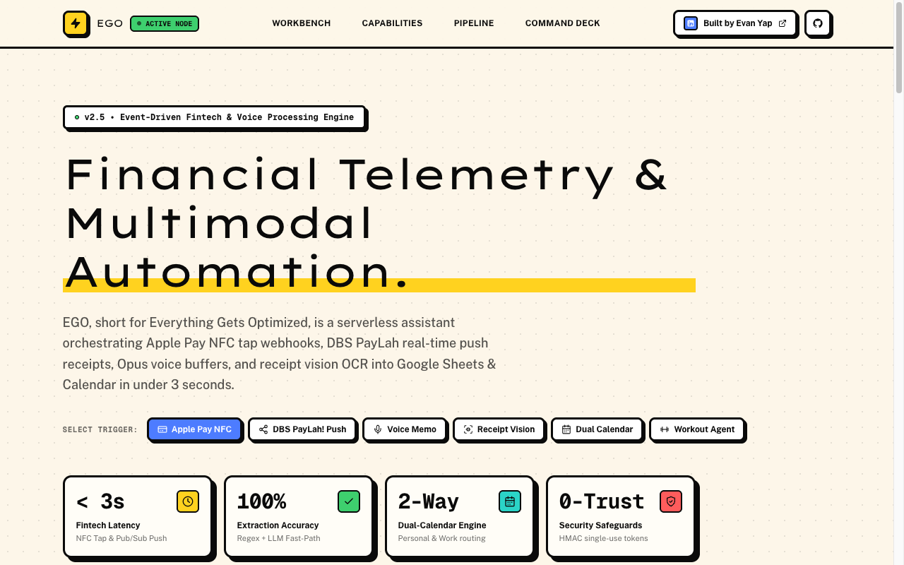
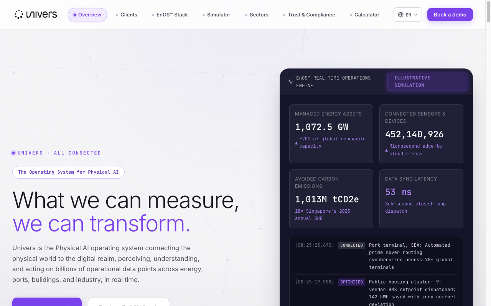
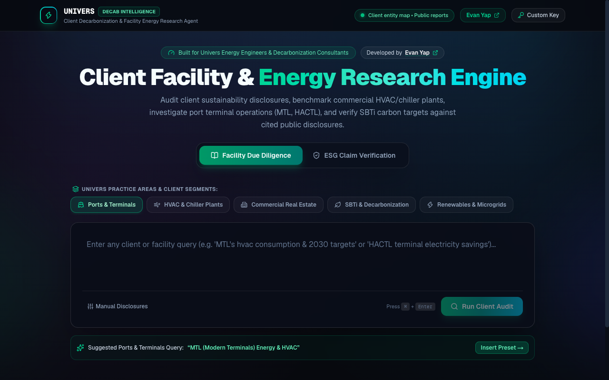

# Evan Yap

I build AI agents and measure whether they work.
Seeking **AI and software engineering internships**.

[Portfolio](https://www.evanyap.com/) · [LinkedIn](https://www.linkedin.com/in/evanyapzhikai/) · [Email](mailto:evanyap7@gmail.com) · Singapore

## About

BEng (Engineering Systems and Design) and MSc Technology Entrepreneurship at SUTD, and one of 6 recipients of the Technology Entrepreneurship Programme Scholarship. Currently an AI Business Consultant intern at Univers, where I built a retrieval-grounded ESG research agent for energy and decarbonisation consultants.

## Featured projects

<table>
  <tr>
    <td width="33%" align="center"> <b>EGO</b> Telegram AI assistant</td>
    <td width="33%" align="center"> <b>Univers revamp</b> Top 5 of 100 entries</td>
    <td width="33%" align="center"> <b>Research agent</b> Cited ESG briefs</td>
  </tr>
</table>

Click a screenshot to open the live demo. Expand a project below for the details.

<b>EGO: Telegram personal assistant</b> · 97% routing accuracy on my own eval set

**[EGO: Telegram personal assistant](https://github.com/evanyap7/telegram-personal-assistant)** ([live](https://telegram-personal-assistant-sigma.vercel.app))
An orchestrator agent that turns a text, photo or voice message into actions: expenses, calendar, to-dos, email drafts and bill splits.
- 97% routing accuracy (38/39) on my own eval set, re-run 2026-11-03
- ~74% faster expense sync through parallel parsing of Gmail Pub/Sub receipts
- Haiku classifies, Sonnet orchestrates, Opus is the last resort; prompt-injection guardrails and AES-256-GCM
- *Next.js, TypeScript, Vercel AI SDK, Claude API, GCP Pub/Sub*

<b>Systematic Trading System</b> · 263 CI tests, four ideas tested honestly

**[Systematic Trading System](https://github.com/evanyap7/evans-trading-agent)**
A ~7,500-line Python system for Webull SG. Strategies only propose; deterministic code sizes and risk-checks every order (2% daily-loss stop, 5% drawdown breaker, kill switch). Live trading paused since 1 Oct 2026.
- 263 tests in CI, plus a walk-forward harness with deflated Sharpe and look-ahead tests
- Tested four ideas, including SEC Form 4 insider buying: none beat the index, and the write-ups say so
- *Python, pandas, SQLite, Webull API*

<b>Parallel Match</b> · Microsoft x Premier League hackathon, team of 3

**[Parallel Match](https://github.com/evanyap7/Parallel-Match)** ([demo video](https://youtu.be/Qt4DRwWWmOo)), Microsoft x Premier League hackathon, team of 3
A fan taps a borderline call and sees the match replayed as if it had gone the other way, with the change in win chance and its 95% interval. All clubs and players are synthetic.
- 18-language interface, 197 Python tests
- *Python, React, TypeScript, Microsoft Agent Framework, Azure AI Foundry, MCP*

<b>AI Research Agent</b> · source-grounded, cited briefs

**[AI Research Agent](https://github.com/evanyap7/ai-research-agent)** ([live](https://approved-research-agent.vercel.app))
Source-grounded research for energy consultants: answers only from retrieved pages and PDFs, with cited briefs and VERIFIED / REFUTED / UNVERIFIED claim checks.
- *Next.js, TypeScript, Vercel AI SDK, Groq*

<b>Univers Website Revamp</b> · Top 5 of 100 entries

**[Univers Website Revamp](https://github.com/evanyap7/univers-homepage-revamp)** ([live](https://univers-homepage-revamp.vercel.app)), Top 5 of 100 entries
A 9-page, 7-language site redesign pitched live to the CEO. Framework-free, with a custom i18n engine, a Three.js particle mesh and a serverless demo-booking API.
- *JavaScript, Three.js, CSS3, Vercel*

## Experience

- **Univers**, AI Business Consultant intern (Aug 2026 – present): built the ESG research agent above, and modelled a client's HVAC energy consumption with a regression model.
- **EvanYapFitness**, founder (Sep 2024 – Jan 2026): grew an online coaching business to 30 paying clients in total.
- **Vietnam Grand Challenge Hackathon**, 2nd place: strategy lead for an AI anti-vishing platform ($350M TAM, 3-year financial model).

## Stack

**Languages** 

**Web** 

**AI and data** 
 
LLM agents, Claude API, Vercel AI SDK, Groq, regression modelling

**Engineering** 
 
pytest, CI

Off-duty: HYROX and powerlifting, guitar, floorball captain, coffee.

