 

 

<table align="center">
  <tr>
    <td width="440" valign="middle"></td>
    <td width="420" valign="middle"></td>
  </tr>
</table>

 

 

## The same year, four more ways

**Pulse** · each week's total on one line, with the busiest week marked

  

**Ring** · weekdays are the rings, weeks are the spokes, a clock hand reveals the year

  

**Streak** · the current run traced day by day, ending at the last day off

  

**Terminal** · every day scrambles, then settles on <code>. : + # @</code> by activity level

 

How this works

 

A profile README can't run JavaScript, so each view is a self-contained animated SVG generated from my own contribution data.

1. `scripts/fetch_contributions.py` reads the public contributions page and saves a small `data/contributions.json` (date, count, level for each day, plus streaks). No token needed, and the images never call GitHub themselves.
2. `scripts/render_heatmap_svg.py`, `render_skyline_svg.py` and `render_views_svg.py` turn that file into the six SVGs. Animation is plain CSS and SMIL: per-cell delays create the diagonal wave, the skyline's square-root heights stop one huge day flattening everything else, and each view plays once then holds the finished frame.
3. A GitHub Action (`.github/workflows/update-profile-art.yml`) re-runs all of it every six hours and commits the result as me, so the graphs stay current without anyone touching them.

Users with reduced-motion turned on get the finished frame immediately. Hover any cell for its exact count and date.

