 

 

 

<table align="center">
  <tr>
    <td width="440" valign="middle"></td>
    <td width="420" valign="middle"></td>
  </tr>
</table>

 

 

## Things I've built

| | |
|---|---|
| [**EGO**](https://github.com/evanyap7/telegram-personal-assistant) | A personal Telegram assistant that handles expenses, scheduling, to-dos, email drafts, habits and bill splitting. Next.js, TypeScript, Claude. |
| [**AI Research Agent**](https://github.com/evanyap7/approved-research-agent) · [live](https://approved-research-agent.vercel.app) | Source-grounded research for energy engineers and decarbonisation consultants: cited briefs and ESG claim verification. |
| [**Trading Agent**](https://github.com/evanyap7/evans-trading-agent) | An autonomous swing-trading agent for Webull Singapore. |
| [**Parallel Match**](https://github.com/evanyap7/Parallel-Match) | Built for the Microsoft x Premier League Inside the Game hackathon, using synthetic data only. |

 

**[evanyap.com](https://www.evanyap.com/)**

