# Evan Yap

SUTD engineering and entrepreneurship student who ships production AI agents.
Seeking **SWE, AI engineering and quant internships**.

[Portfolio](https://www.evanyap.com/) · [LinkedIn](https://www.linkedin.com/in/evanyapzhikai/) · [Email](mailto:evanyap7@gmail.com) · Singapore

## About

BEng (Engineering Systems and Design) and MSc Technology Entrepreneurship at SUTD, and one of 6 recipients of the Technology Entrepreneurship Programme Scholarship. Currently an AI Business Consultant intern at Univers, where I built an ESG audit agent that saves ~3 hours of research per facility audit.

## Featured projects

**[EGO: Telegram personal assistant](https://github.com/evanyap7/telegram-personal-assistant)** ([live](https://telegram-personal-assistant-sigma.vercel.app))
An orchestrator agent that turns a text, photo or voice message into actions: expenses, calendar, to-dos, email drafts and bill splits.
- 97% routing accuracy (34/35) on a live eval set
- ~75% faster expense sync through parallel parsing of Gmail Pub/Sub receipts
- Claude model router (Haiku → Sonnet → Opus failover), with prompt-injection guardrails and AES-256-GCM
- *Next.js, TypeScript, Vercel AI SDK, Claude API, GCP Pub/Sub*

**[Systematic Trading System](https://github.com/evanyap7/evans-trading-agent)**
A ~6,500-line Python system that places real orders on Webull SG. Strategies only propose; deterministic code sizes and risk-checks every order (2% daily-loss stop, 5% drawdown breaker, kill switch).
- 191 CI tests, plus a walk-forward harness with deflated Sharpe and look-ahead tests
- 4 studies, including 518 insider-buy events, found no edge, and I report that as it is
- *Python, pandas, SQLite, Webull API*

**[Univers Website Revamp](https://github.com/evanyap7/univers-homepage-revamp)** ([live](https://univers-homepage-revamp.vercel.app)), Top 5 of 100 entries
A 9-page, 7-language site redesign pitched live to the CEO. Framework-free, with a custom i18n engine, a Three.js particle mesh and a serverless demo-booking API.
- *JavaScript, Three.js, CSS3, Vercel*

**[AI Research Agent (demo)](https://github.com/evanyap7/approved-research-agent)** ([live](https://approved-research-agent.vercel.app))
A public demo of source-grounded research with cited briefs and ESG claim verification.
- *Next.js, TypeScript, Vercel AI SDK, Groq*

## Experience

- **Univers**, AI Business Consultant intern (Aug 2026 – present): built an ESG audit agent and an HVAC energy regression model that lands within 2–3 percentage points of observed consumption.
- **EvanYapFitness**, founder (Sep 2024 – Jan 2026): grew an online coaching business to 30 paying clients and $4k monthly revenue.
- **Vietnam Grand Challenge Hackathon**, 2nd place: strategy lead for an AI anti-vishing platform ($350M TAM, 3-year financial model).

## Stack

- **Languages:** Python, TypeScript, JavaScript, C++, C, SQL
- **Web:** Next.js, React, Node.js, Three.js, Vercel
- **AI and data:** LLM agents, Claude API, Vercel AI SDK, Groq, regression modelling

Off-duty: HYROX and powerlifting, guitar, floorball captain, coffee.

